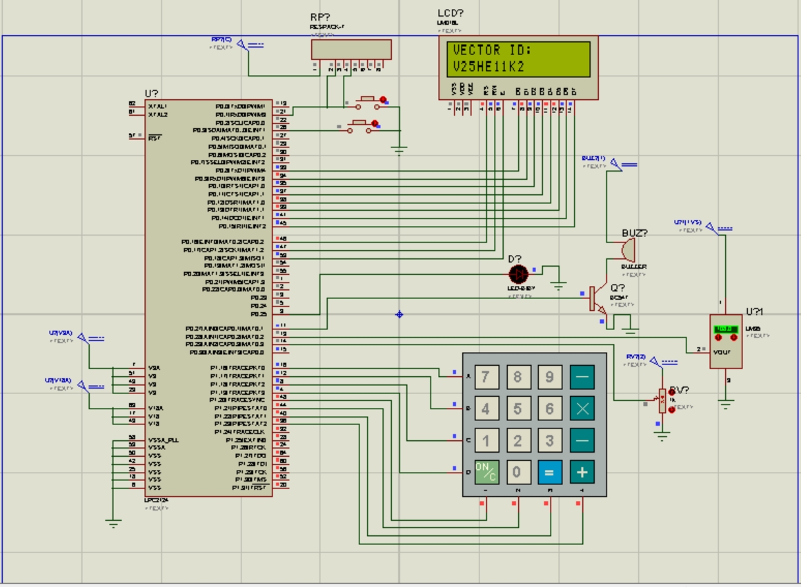
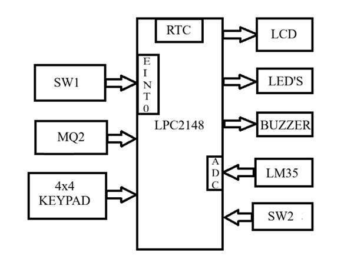
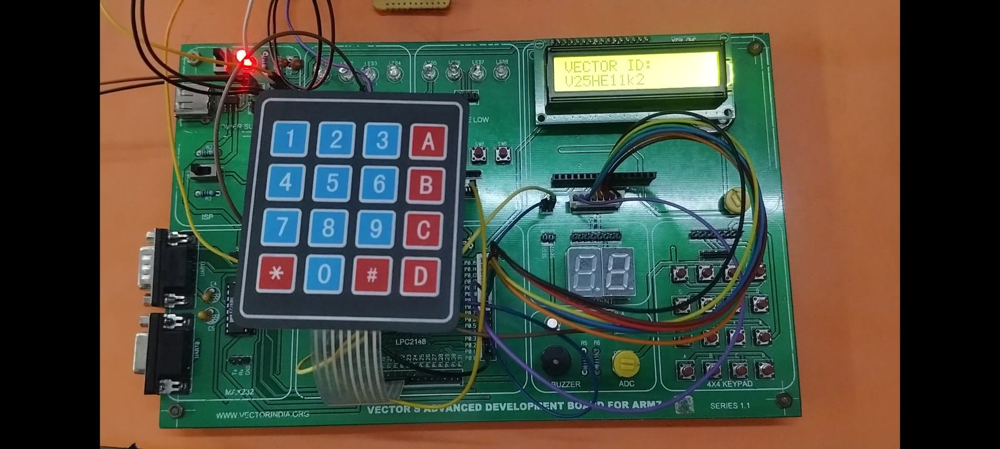
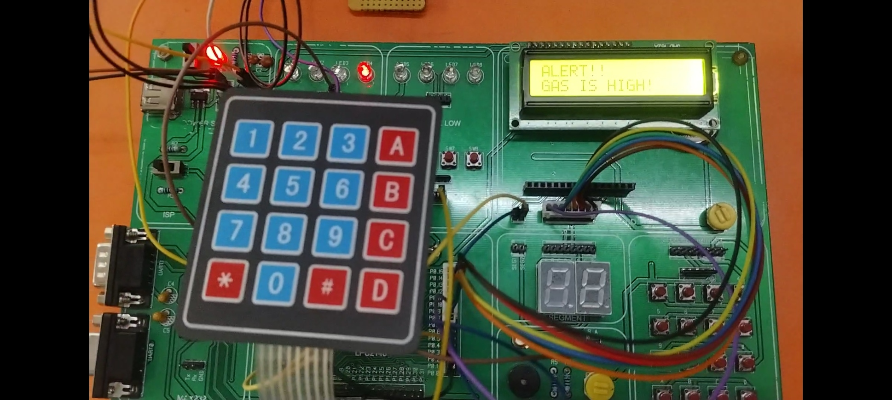
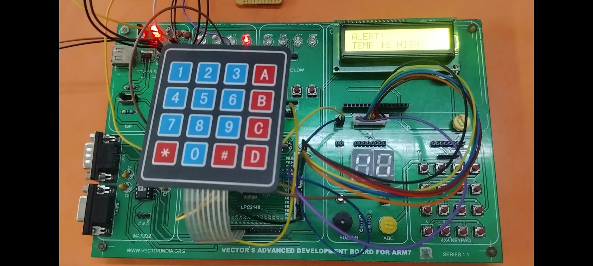
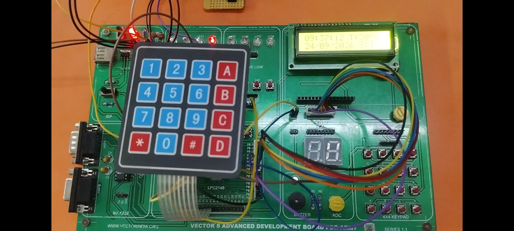

# Kitchen Safety Heat and Gas Monitoring System

## Project Overview

The Kitchen Safety Heat and Gas Monitoring System is an ARM7-based embedded systems project designed to monitor temperature and gas sensor levels. The system reads sensor values through the Analog-to-Digital Converter (ADC), displays the readings on an LCD, and uses an LED indicator to signal when the configured gas threshold is exceeded.

The project is developed and tested using Proteus simulation.

## Objectives

- Monitor temperature using the LM35 temperature sensor.
- Read gas sensor output through the ADC.
- Display sensor readings on an LCD.
- Indicate gas threshold conditions using an LED.
- Understand ARM7 microcontroller programming and peripheral interfacing.

## Hardware Components

- ARM7 microcontroller (specify the exact model used)
- LM35 temperature sensor
- Gas sensor (as configured in Proteus)
- 16×2 LCD display
- LED indicator
- Current-limiting resistor
- Power supply and circuit connections

## Software and Tools

- Embedded C
- Proteus Design Suite
- ARM7 microcontroller programming tools

## Working Principle

1. The temperature and gas sensors provide analog signals.
2. The ADC converts the analog signals into digital values.
3. The microcontroller processes the sensor readings.
4. Temperature and sensor information are displayed on the LCD.
5. The LED indicates when the gas reading crosses the configured threshold.

## Project Structure

- `main.c` — Main application program
- `ADC.c` / `ADC.h` — ADC interfacing
- `LM35.c` / `LM35.h` — Temperature sensor functions
- `LCD.c` / `LCD.h` — LCD interfacing
- `defines.h` — Project definitions
- `images/` — Circuit diagrams and simulation screenshots

*The filenames and folders above should match the actual files uploaded to this repository.*

## Simulation Results

The project is tested in Proteus to observe:

- ADC readings and input voltage values
- Temperature readings on the LCD
- Gas sensor readings
- LED response above and below the configured threshold

## Project Images

## Future Enhancements

- Audible alarm integration
- Improved sensor calibration
- Real-time monitoring and event logging
- Testing with physical hardware

## Author

**Katroth Sandeep**

B.Tech in Electronics and Communication Engineering

GitHub: [katroth-sandeep](https://github.com/katroth-sandeep)
